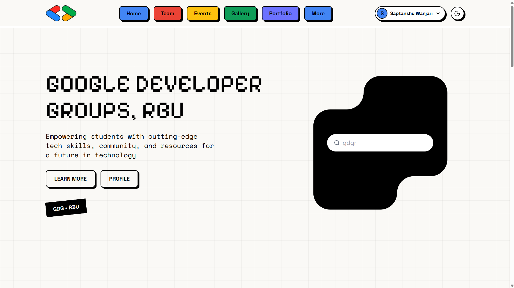
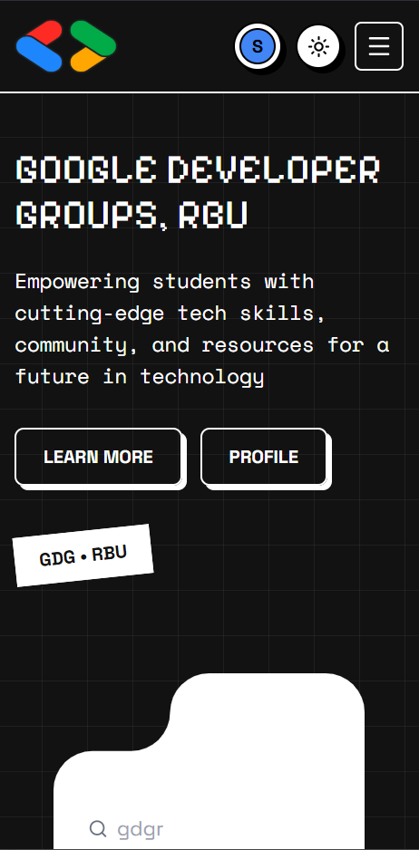
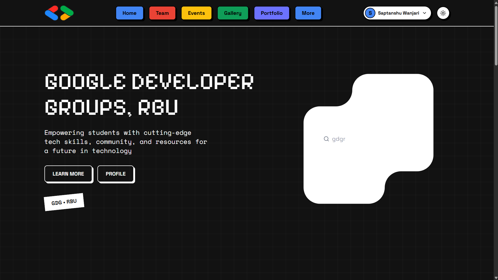

# GDG RBU Frontend Task

This is a frontend landing page built for the GDG RBU recruitment task. The goal was to build a responsive, interactive page following a neo-brutalist design reference.

## Tech Stack

- Next.js (App Router)
- TypeScript
- Tailwind CSS
- Framer Motion
- next-themes

## Features

- Responsive design that works well across mobile, tablet, and desktop screens.
- Dark and light mode toggle.
- Subtle scroll and interactive animations (which respect user reduced-motion preferences).
- Accessible, using semantic HTML, ARIA labels, and clear keyboard focus outlines.

## Live Demo

[Link to Live Demo](https://gdg-rbu-aj.vercel.app/)

## Folder Structure

```text
├── design/              # Design reference screenshots
├── public/
│   └── images/          # Static assets (logo, shapes, team image)
├── src/
│   ├── app/
│   │   ├── globals.css  # Global Tailwind configuration and CSS variables
│   │   ├── layout.tsx   # Root layout and theme provider setup
│   │   └── page.tsx     # Main page assembling all sections
│   └── components/      # Individual UI sections and elements
│       ├── FAQ.tsx
│       ├── Footer.tsx
│       ├── Hero.tsx
│       ├── Navbar.tsx
│       ├── Team.tsx
│       ├── ThemeProvider.tsx
│       ├── ThemeToggle.tsx
│       └── UpcomingEvent.tsx
├── next.config.ts
└── package.json
```

## How to Run Locally

Clone the repository and install the dependencies:

```bash
npm install
```

Start the development server:

```bash
npm run dev
```

Open http://localhost:3000 in your browser to view the page.

To build the project for production, run:

```bash
npm run build
```

## Screenshots

### Desktop


### Mobile


### Dark Mode


## What I would improve

If I were to take this project further, a few things I would improve include:
- Fetching real event data from a backend API or CMS instead of using hardcoded objects.
- Writing tests for the interactive components (like the mobile menu and FAQ accordion) to make sure they are robust over time.
